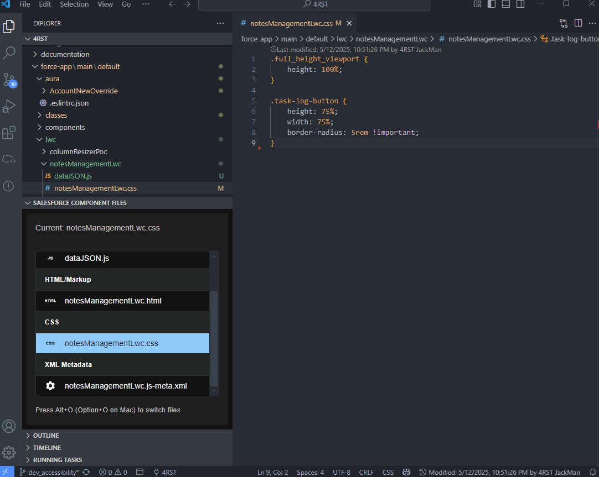
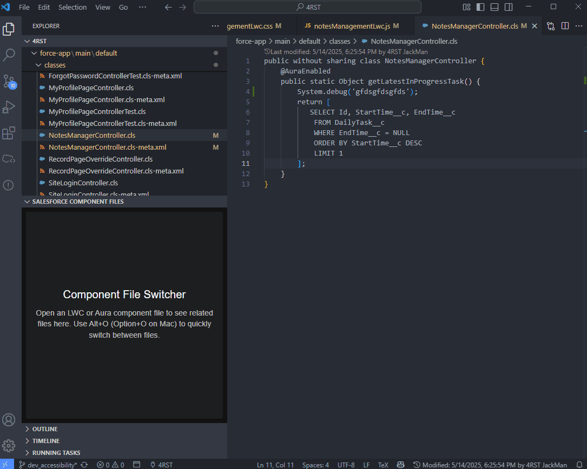
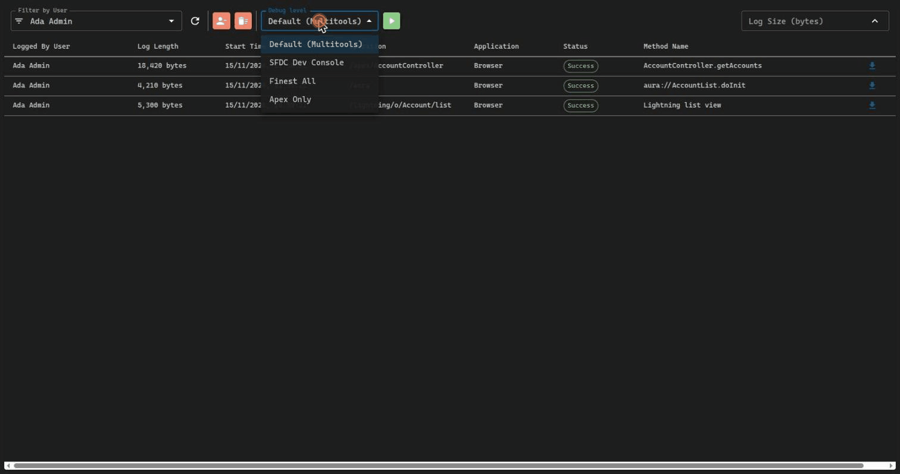
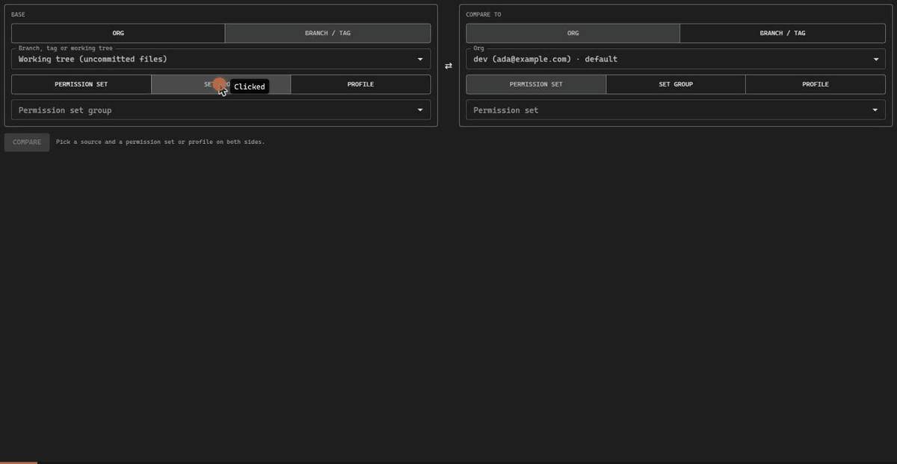

# ✨ Salesforce Multitools - Level Up Your SF Dev Game! ✨

This VS Code extension boosts your productivity and streamlines your Salesforce development workflow. 😎

## 🔥 Features Overview 🔥

### 🚀 Component File Switcher

Tired of clicking through folders to find your Lightning component files? We fixed that!

- **Keyboard Shortcut**: Use `Alt+O` (or `Option+O` on Mac) for quick access
- **Sidebar UI**: View all your component files in one spot, no scrolling needed

When you're working with Lightning components:

1. Press `Alt+O` (or `Option+O` on Mac) to activate
2. Files appear based on the hierarchy (prioritizing the important ones):
    - For LWC: JS file is the primary file, followed by HTML & CSS
    - For Aura: Controller.js takes priority, then the component file & CSS

The sidebar provides a clean interface with:

- Component name & type with LWC/Aura indicators
- Files grouped by type for better organization
- Unsaved files get a special indicator
- Current file is highlighted for easy reference

### 👀 Last Modified Details

See who modified your code last and when, get notified and blame them!

- Track who last modified each Salesforce component
- Displays timestamps of when changes were made
- Integrates with CodeLens for in-line visibility
- Automatic refresh at configurable intervals (`salesforceMultitools-3.lastModifiedAutoRefreshInterval`, default 15 seconds, `0` turns it off). Refreshing pauses while the window is not focused

### 🔍 Debug Log Fetcher

Fetch and analyze Salesforce debug logs with enhanced filtering and UI:

- **Command**: Use `Salesforce Multitool: Open Debug Logs` or from the Command Palette (`Ctrl+Shift+P` / `Cmd+Shift+P`)
- User-specific log filtering with typeahead search, plus filtering by log size (above or below a size you choose)
- Interactive log viewer with method name tracking
- Responsive table with tooltips and optimized layout
- One-click download and open in VS Code; downloaded logs are saved in your project (`.sfdx/_multi-tool/debug-logs`) so reopening is instant
- Delete one log, all logs, or all logs of one user (more than 2000 at once is fine); you are asked to confirm first
- **Start and stop logging for a user** right from the toolbar. Pick the debug level to use: one of your org's existing debug levels or the built-in default (a lighter level that keeps logs small). Your choice is remembered, and the level in use is shown next to each active trace flag

### 🔐 Permission Compare

Compare a permission set or profile between two sources, side by side:

- **Command**: `Salesforce Multitool: Compare Permission Sets / Profiles`
- Compare **org vs org**, **branch vs org** or **branch vs branch** (also tags and your uncommitted files). Branch sources need the project to be under git
- Org data is read with SOQL and the Metadata API, so it is complete (a CLI retrieve of a profile or permission set is not). Profiles also compare login hours and login IP ranges
- Smart diff: compares the permissions actually granted, ignoring ordering, formatting and implied permissions (for example Edit implies Read)
- Two columns, one per side, with differences highlighted. Filter by permission type (click one chip to show only that type, click more to add them), added / removed / changed, or name

## 🔮 Coming Soon! 🔮

- **Salesforce Constantinator** - Convert hardcoded strings into constants

## 💯 Requirements

- VS Code 1.90.0+
- Salesforce CLI, with an authorized org. The extension uses your project's default org (`target-org` in `.sf/config.json`, or `defaultusername` in `.sfdx/sfdx-config.json`) and falls back to your global setting
- The extension starts only in Salesforce projects, meaning workspaces that contain `.sf/config.json` or `.sfdx/sfdx-config.json`

## 🤓 Installation 🤓

Available from the VS Code Marketplace and Open VSX, or download the VSIX file from the GitHub releases.

## 🛠️ Want to Contribute? 🛠️

### Build from source:

1. Clone the repo
2. `pnpm install` to get dependencies
3. `pnpm run compile` to build
4. Press F5 to start debugging

See [docs/development/building.md](./docs/development/building.md) for details.

---

_This extension was built to make Salesforce development more efficient and enjoyable. Thanks for checking it out!_
